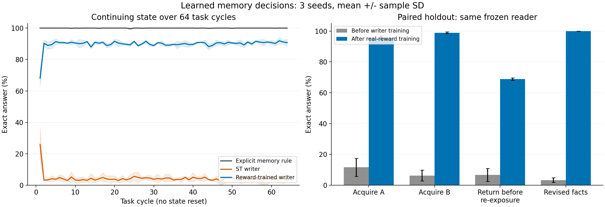
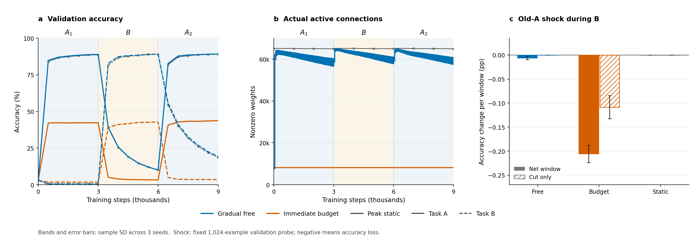

# 持续输入、学习读写与结构渐变：实现和实测

日期：2026-10-26。接续[上一轮记忆与循环实验](persistent-experiment-2026-10-26.md)。本轮检验三个问题：记忆选择与停止能否通过任务后果训练；活动相关局部更新能否累积能力；新连接出现时允许旧连接逐步退出，是否比立即替换更稳。

**结果表明，保留/丢弃记录、读取和停止都可以成为训练对象；允许新旧连接共存也减少了预算硬剪造成的瞬时冲击。但目前没有得到稳定的终身学习系统：记忆策略仍偏向新任务，权重学习仍明显覆盖旧能力，结构存续不等于功能存续。**

这不是一个新的强制架构。下面几组实验刻意分开，以辨认反馈、存储、训练目标和结构变化各自的作用。所有主表均为三个种子的均值 ± 样本标准差，不是置信区间。

代码及命令见 [streaming/README](../experiments/streaming/README.md)。可入库的[流实验完整指标](evidence/streaming-2026-10-26/stream-results.json)与[结构实验完整指标](evidence/streaming-2026-10-26/structure-results.json)保存了种子、配置、逐阶段结果和来源哈希；检查点及较大日志保存在本机 `data/streaming/`。

## 1. 连续输入中的记忆、读取与停止

### 环境和模型

每个世界有 12 个上下文、64 个符号。相关上下文各有 8 条事实，形成两条不同终点的链；查询随机起点，模型沿事实回答终点。不同上下文使用相同的键但给出不同答案。事实包含可观察的终止标记；**模型没有获得正确步数，停止头也不是推理正确性的自评器。**

观察流先涉及任务 A，再涉及 B；随后随机回到 A 或继续 B。在这一回测之前不会重新提供所需事实。之后，同一上下文的事实再发生修订，要求采用新答案。其余上下文持续提供干扰。上下文名称、键、链长、呈现顺序与训练干扰长度均随机化，避免固定键或固定第三阶段日程直接指示答案。

模型共 431,109 个参数，包含 256 维需求状态、共享寻址器、记录保留评分与 3 参数停止头，最多进行 10 次读取。它只有 16 个原始记录槽位，恰能容纳两个相关上下文。写入动作是替换某个槽位或丢弃来项；前向槽位只能保存真实完整记录，不能用软混合暗中增加容量。

空槽分配、定位已有 `(context,key)` 和记录请求时间是明确的接口条件。保留评分可以使用距某上下文上次请求的时间，但没有获得“哪些记录重要”的标签。需求隐藏状态不接收事实值或答案；读出不能绕过缓存访问需求隐藏状态。该隔离用于检验缓存机制，不是未来架构必须遵守的规则。

### 训练边界

1. 先用“优先保留最近两个被请求上下文”的明确缓存规则训练读取器，800 次更新、batch 512。这个规则记为 MRU，含有工程化的相关性知识，并非模型学会的写入策略。
2. 软停止训练与硬部署曾发生失配：一个种子能在正确深度读出答案，却一直读到上限。固定读取器后，所有种子统一只训练停止头的 3 个参数 200 次，使用最终答案的期望候选损失。没有正确步数监督或停止阈值搜索。
3. 冻结同一读取器与停止头，训练写入策略。straight-through（ST）组用最终答案监督和替代导数，800 次更新；奖励组采样实际写入动作，只收到后续查询的二值正确性，使用 REINFORCE 与批内 leave-one-out 基线，200 次更新、batch 512，没有自评 critic。

ST 和奖励组的反馈信息、优化方式、更新预算及训练随机流不同，二者的差距不能全部归因于某一个算法因素。奖励组的主要证据是**同一初始模型、同一测试世界、同一冻结读取器，训练写入策略前后的配对比较**。

训练每个完整任务循环后更新参数，继续携带缓存和需求状态，只截断计算图。评估中参数冻结，缓存与需求状态持续变化。因而下面支持的是已学记忆策略的持续运行，尚不是评估时所有参数共同演化且不遗忘的系统。

### 读什么、何时停可以学会

在明确缓存规则保住事实的条件下，最终硬停止测试准确率为 **99.99 ± 0.02%**，平均 **3.01 ± 0.01** 次逻辑读取。强制只读一次为 26.00%，强制读满十次为 29.32%；后者会在到达任务终点后继续改变候选，不能推广成“思考越久越差”。

停止头额外训练前，三个种子的平均准确率为 75.79 ± 40.06%；其后接近 100%。所有非停止参数的哈希完全不变。这定位了本次软训练和硬部署之间的失配，不能说读取器没有学到路径，也不能用软混合准确率冒充实际停止成绩。

`reads` 表示逐世界的逻辑读取次数。批量实现尚未裁剪已停止的行，因此不能把读取次数下降直接换算成同倍数的 GPU 时间节省。

### 记什么确实发生了学习，但旧任务仍未完整保住

每个测试条件、每个种子有 16,384 条查询，每阶段 4,096 条；查询共享世界，不能把它们都当作独立随机样本。

| 条件 | 奖励训练前的写入策略 | 奖励训练后的写入策略 |
|---|---:|---:|
| 标准持续流整体 | 6.98 ± 3.68% | **90.83 ± 0.35%** |
| 回测阶段（随机回 A 或留 B） | 6.71 ± 4.23% | 68.90 ± 0.77% |
| 接受同一上下文的事实修订 | 3.33 ± 1.42% | 99.97 ± 0.06% |

这个改善来自写入评分及需求状态参数的更新；读取器与停止头逐值不变。写入策略只从实际回答的对错学习，没有写入、路径或步数教师标签。

不过，混合回测会掩盖偏向新任务的问题：**强制回到旧 A 时，回测成功率只有 40.85 ± 0.87%；继续 B 时为 99.07 ± 0.44%。** 干扰提高到 32 条时，整体为 79.21 ± 0.79%，混合回测为 53.94 ± 0.86%。所以当前结果是学到了有用的选择策略，而非已解决旧经验保留。

诊断进一步表明，奖励模型完整保留所需链的比例约 82.98%；链完整时读出基本正确。同一模型仅换回明确缓存规则即可恢复约 99.99%，表明剩余主要瓶颈是记录选择。擦除缓存并保留其它状态后只剩 1.58%，接近 1/64，未发现隐藏状态绕过缓存携带答案的证据。

### 更长的持续输入

另用全新随机流进行 64 个任务循环、64 条并行流的 CPU 配对测试，每条流连续接收 **8,384 个事件**，全程不重置缓存或需求状态。每个种子有 32,768 条查询。

| 写入方式 | 整体准确率 | 混合回测准确率 |
|---|---:|---:|
| 明确缓存规则 | 99.98 ± 0.02% | 99.98 ± 0.03% |
| 本次 ST 写入实现 | 4.39 ± 1.86% | 3.74 ± 2.22% |
| 奖励学习的写入策略 | **89.89 ± 0.26%** | **66.41 ± 0.32%** |

奖励策略在较长流中保持了其有限能力，仍未达到强规则基线；ST 的这次实现没有学稳。三种方式在这项长流测试中使用相同世界和设备，但其训练配方不同，表格不是对所有 ST 或强化学习方法的普遍比较。

为检查训练预算，另外保留一个固定到 1,000 次更新的独立验证运行，未用其测试结果选模。同一起点的 200/1,000 次更新模型在新 32 循环验证流末八个循环分别为 92.82%/93.58%，强制回旧 A 的回测分别为 42.94%/43.85%；但前两个循环的整体成绩由 88.96% 降至 78.13%。这提示冷启动与持续状态分布需要分开检查，不能把短验证的下降直接当作能力上限。该单种子检查没有补上旧记忆缺口，也不替代三种子主表；[验证数据与曲线](evidence/streaming-2026-10-26/budget-validation.json)单独保存。

## 2. 按活动次数/频率学习，有没有空间

这里按用户澄清检验的是活动相关局部更新，不是 Forward-Forward。旧 LIF 代码实际上已有 `pre_trace × (post_trace−θ) × 外来反馈`、活动率调节和连接生删，并非仅计算发放次数。原代码对应关系、完整实验和文献见[局部学习补充说明](streaming-local-notes-2026-10-26.md)。

受控任务给出可观察上下文，同一输入在 A/B 上下文有冲突标签，按 A→B→A 顺序训练。输入含工程化的上下文交互特征，因此这里只检验更新与干扰，不证明模型自己学出了表示，也不是脉冲 LIF 仿真。

| 更新方式 | 首次学 A | 学 B 后旧 A | 新 B |
|---|---:|---:|---:|
| 冻结 | 38.51% | 38.51% | 32.65% |
| 仅把输出频率调向均匀 | 38.82% | 37.43% | 33.17% |
| 局部 delta / 单层 BP | 98.16% | 52.62% | 97.93% |
| 活动资格量 × 真实二值奖励 | 96.92% | 55.31% | 96.55% |

单层局部 delta 与这里的 BP 数学等价，不能包装成一种更强的新算法。奖励调制的局部更新也有梯度估计的含义。可以确认的是：活动能参与任务学习，真实后果可以给更新方向；**仅把活动频率调均匀没有学会这个任务，局部更新也没有天然防止遗忘。**

## 3. 新连接出生后，让旧连接逐步退出

### 实现没有强制一长一删

较大实验采用 1,024 维原始输入、32 类、2,050 维上下文特征，共 65,600 个潜在权重，是小对照的约 331 倍。训练池 262,144 个样本；每阶段 3,000 次更新、batch 2,048，三个种子均完整运行 A→B→A。

所有组共享同一局部任务残差更新和相同连接成本。渐进组允许新旧边共存：已有权重经任务更新和 L1 软收缩逐步变化，只有到零才退出；新边从非活动位置的局部相关累积中出现，出生不要求另一条边死亡。旧边也可以因后续学习重新增强。没有额外规定新边必须存活多少步。

立即预算组在结构窗口保留固定数量的强连接，可能切断仍非零的旧边。另设固定小稀疏、稠密、以及从训练轨迹得到更大连接池的静态对照。后者的池大小来自渐进组逐输出峰值，只看训练轨迹，不用测试集挑容量；它提供容量解释的对照，不是对过渡连续性的完全因果隔离。

### 硬剪确实造成即时冲击

在 B 阶段，每个结构窗口前后使用相同的旧 A 验证探针：

| 度量 | 立即预算替换 | 渐进共存 |
|---|---:|---:|
| 包含新生与删除的平均净变化 | −0.206 ± 0.018 个百分点 | −0.006 ± 0.003 个百分点 |
| 仅应用旧边删除、不加新边的反事实变化 | −0.109 ± 0.024 个百分点 | 0 |
| 仅删除旧边的最坏单窗口 | −2.344 个百分点 | 0 |

这支持用户提出的具体担心：守预算而硬切旧边会产生可测的即时损害。净变化包含新生影响，不能全部归因于删除；只删旧边的反事实探针进一步分离了这项影响。渐进组没有非零旧边硬剪，故其该项为零并不等于所有结构更新都无干扰。

### 最终能力收益仍主要可由容量解释

| 结构方式 | 首次学 A | 学 B 后旧 A | 新 B | 再学 A |
|---|---:|---:|---:|---:|
| 固定小稀疏 | 16.87% | 3.34% | 16.82% | 16.89% |
| 立即预算替换 | 42.52% | 3.40% | 42.75% | 43.39% |
| 渐进共存、自由连接数 | **89.00%** | **10.46%** | **88.84%** | **89.28%** |
| 峰值容量静态对照 | 88.73% | 10.38% | 88.73% | 89.13% |
| 稠密对照 | 88.96% | 10.41% | 88.88% | 89.27% |

自由组由 8,192 条连接增长到峰值约 65,107，最终约 60,807，已经接近稠密网络。每个种子发生约 48 万次出生和约 43 万次归零退出，这是可重复连接位置的累计事件。立即预算组各有约 1.8 万次非零旧边硬剪，自由组没有。

约 70% 的 A1 连接在学完 B 后一直未归零，但旧 A 成绩仍从 89.00% 降至 10.46%。**连接还在，权重所表达的旧功能也可能已经改变。** 当前没有证据表明仅让旧边慢退出就解决了长期保持。

L1 本身也有代价：独立的无 L1 验证对照表现更好，不能把正则化造成的遗忘当作所有自组网络的必然限制。这里没有据测试集继续选择成本。全代码用稠密数组保存候选统计，实际非零边与分配数组大小分别记录，不声称得到稀疏计算加速。

图中的学习曲线和窗口冲击使用验证集，正文主表使用独立测试集；误差带按三个种子计算，不把同一种子的多个窗口当独立样本。

## 4. 对下一步判断的影响

记忆、循环和停止接受共同任务后果的训练，是“把使用工具变成模型能力”的一个可操作版本。本轮学习出的写入策略已经有明显收益，但其对旧任务的偏置尚在；把算子放进同一计算图也没有自动解决离散写入的训练问题。

结构自由度可以提供过渡空间。已经观察到减少硬剪冲击的作用，但还不能把它等同于更强的知识累积。后续最有辨别力的问题，是旧功能具体由哪些参数更新破坏，以及怎样从真实经验中学习保留它；不能仅以旧连接仍存活或活动率平稳作为成功标准。

本轮没有加入自评正确性模型。停止头依赖任务中可观察的终止信息；奖励来自环境实际对错。它们不能证明模型已能通过自主推理发现自己的错误，也不要求先假定模型具备这种能力。

## 复核与适用范围

- RTX 4060 Ti 8GB、i5-14600KF、约 32GB RAM；CUDA PyTorch 2.11.0+cu130。较大训练实际使用 GPU；部分作业并行期间观测到约 93% 利用率。并行计时不能当作独占 GPU 吞吐基准。
- 正式固定最后检查点；pilot 和未完成的计时测试不进入主表。数据、动作采样、验证和测试随机流分开；所有报告保留种子和来源哈希。
- [源码指纹复核](evidence/streaming-2026-10-26/source-verification.json)确认 35 处正式运行的源码引用与当前文件一致；本轮源码另保存于 `data/streaming/final-source-2026-10-26/`。
- 70 项自动化检查通过；奖励写入另通过自身语义检查及独立的时序奖励、基线、冻结与数据来源审查。
- 长流评估冻结参数、携带状态；局部/结构分支则更新参数并测试顺序干扰。这些证据尚未合成一个同时学习全部部件、长期非平稳且稳定保持的系统。
- 本轮使用可精确核对后果的随机任务，没有使用 SkyPile 或下载大型基础模型；没有语言、开放世界推理或意识的结论。
- [代码索引](../experiments/streaming/README.md)、[局部学习细节](streaming-local-notes-2026-10-26.md)、[流指标 JSON](evidence/streaming-2026-10-26/stream-results.json)、[结构指标 JSON](evidence/streaming-2026-10-26/structure-results.json)提供复现和逐项复核入口。

相关原始研究可用于理解方法边界：[奖励梯度估计](https://doi.org/10.1007/BF00992696)、[Adaptive Computation Time](https://arxiv.org/abs/1603.08983)、[奖励调制 STDP](https://izhikevich.org/publications/dastdp.pdf)、[e-prop](https://doi.org/10.1038/s41467-020-17236-y)、[SET](https://doi.org/10.1038/s41467-018-04316-3)、[RigL](https://arxiv.org/abs/1911.11134)。本轮使用自己的受控实现，不声称复现这些论文的完整方法或成绩。
