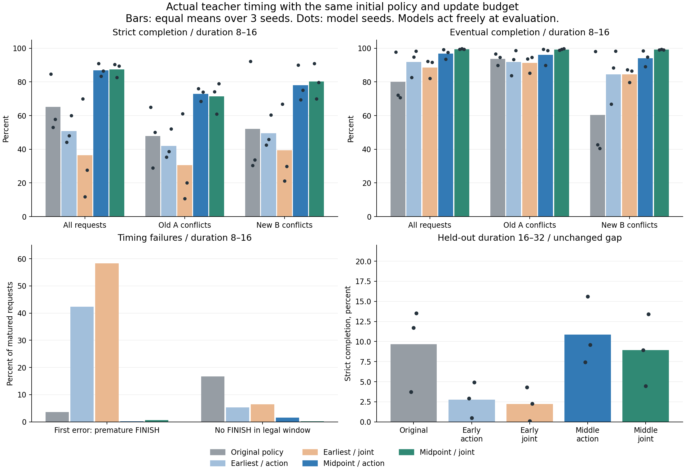

# 中点示范把训练时长内的严格完成提高到约 87%

2026 年 11 月 6 日。保留原策略和训练方法，改用在合法窗口中点结束的真实教师示范，三个种子的严格完成都提高了。**只练动作从首次合法示范的 50.8% 提高到 87.0%，抢答首错从 1,715 个降到 10 个。** 加入时间目标后的严格完成为 87.5%，没有一致的额外严格优势。等待时长加倍后的表现仍很弱。[上一轮的问题](remaining-time-experiment-2026-11-06.md) · [本轮分析方案](../experiments/teacher_timing/analysis-plan.md) · [逐种子结果与来源校验值](evidence/teacher-timing-2026-11-06/results.json)

## 改变的是实际示范方式

实验交叉两个因素：原生教师在首次合法 tick 结束或在合法窗口中点结束；模型只接受动作梯度，或同时接受动作与时间预测梯度。模型仍是相同的 192 维单层 GRU，完整复制原 B008 循环与十一动作头，另有两个零初始化的辅助时间读出。时间值从不决定真实动作，也没有新增合法性门控。

action 的时间读出在停止梯度的 h 上学习，不影响政策更新；joint 的时间损失可以更新循环。两者仍分别裁剪政策与时间头梯度，动作损失、时间尺度、系数、Adam 和学习率均沿用上轮。本轮没有扫描教师位置或损失权重。

中点教师真实执行较晚的 FINISH，因此标签和随后公开的动作回执都会变化。两侧的外部事件、请求身份、内容、启动时刻、就绪时刻、调度和随机状态逐位一致。这个比较可以判断完整示范方式的影响，不能把收益单独归因于某一行标签。[数据协议](../data/teacher-timing/streams-v1/protocol.json) · [完整原生数据审计](../data/teacher-timing/streams-v1/audit_completion.json)

每种子、每条件都是 32 actor、双槽，预热 512 tick 后单次顺序学习 32,768 tick，每 128 tick 更新一次，共 256 次。数值 h 连续保留，块边界只截断梯度，更新后不重算过去状态。两侧总输入、更新次数、动作监督行数相同；时间有效标签数不同，后面单列。

首次合法条件重新训练，全部 18 个对应的第 0、64、256 步存档，其模型、Adam、h、游标与工作计数都逐位复现上轮。因而控制结果没有因为本轮实现变化而漂移。[训练协议](../data/teacher-timing/train-v1/protocol.json) · [历史控制复现](../data/teacher-timing/train-v1/earliest_regression.json)

## 新请求上的实际行动

全部 12 个终点冻结后，在训练外世界与 actor 上自行行动 512 tick，再测 4,096 tick。主要条件处理时长 8–16、空档 16–32。所有测试段新发、外部合格且成熟的请求都进入分母，含没有启动或没有合法窗口的失败。三个种子分别为 1,338、1,363、1,356，共 **4,057 个请求**。表内百分比和空闲误动采用三个种子等权平均，计数为合计。[自主评估协议](../data/teacher-timing/eval-v1/protocol.json)

| 训练示范 / 目标 | 严格完成 | 普通完成 | 旧 A 冲突严格 | 新 B 冲突严格 | 空闲误动 / 千机会 |
|---|---:|---:|---:|---:|---:|
| 原策略，未参加本轮训练 | 65.2% | 80.2% | 48.0% | 52.1% | 7.80 |
| 首次合法 / 动作 | 50.8% | 91.9% | 42.1% | 49.6% | 0.03 |
| 首次合法 / 联合 | 36.5% | 88.6% | 30.6% | 39.3% | 0.07 |
| 中点 / 动作 | 87.0% | 96.8% | 72.8% | 78.1% | 0.73 |
| 中点 / 联合 | 87.5% | 99.5% | 71.4% | 80.2% | 0.05 |

只练动作时，三个种子从 **44.2%、48.1%、60.1%** 提高到 **91.0%、83.3%、86.5%**，严格计数从 **592/655/815** 提高到 **1,218/1,136/1,173**。联合训练也在三个种子上都优于各自首次合法教师的条件。这是在训练时长范围内、同预算、相同新请求上的一致改善。

| 每组同为 4,057 个成熟请求 | 首错为抢答 | 合法窗口内全程未发 FINISH | 合法窗口首次 FINISH 正确 / 错误 |
|---|---:|---:|---:|
| 首次合法 / 动作 | 1,715 | 216 | 3,030 / 811 |
| 首次合法 / 联合 | 2,372 | 264 | 2,824 / 969 |
| 中点 / 动作 | 10 | 65 | 3,534 / 458 |
| 中点 / 联合 | 28 | 6 | 3,564 / 487 |

所有主要条件请求均已启动并实际到过合法窗口，表中的漏发不是少启动造成的。中点示范显著减少抢答，同时没有把策略推成总在等待。普通完成允许早先错误后重试，因此仍与严格完成分开。

中点下 joint/action 的严格计数依次为 **1,209 对 1,218、1,127 对 1,136、1,213 对 1,173**。平均只增加约 0.54 个百分点，提升来自种子 2，其余两个各少完成 9 个。辅助时间目标减少了漏发和空闲误动，但不能据此宣称它稳定提高严格完成。

## 时间标签和历史覆盖到底变了多少

两侧三个种子合计都有 **6,291,456 行动作监督**和 **53,493 行 BEGIN**。就绪前的正时间行数同为 **2,023,992**，时间掩码仍只看当前活跃、已启动及有限就绪时刻，不过滤未来取消或替换。

| 三种子训练段合计 | 首次合法教师 | 中点教师 |
|---|---:|---:|
| 有效时间标签 | 2,056,907 | 2,188,475 |
| 负时间标签，已就绪仍活跃 | 32,915 | 164,483 |
| 其中就绪后不超过 0.25 单位 | 32,915 | 32,915 |
| 就绪后 0.25–1 单位 | 0 | 98,733 |
| 就绪后超过 1 单位 | 0 | 32,835 |
| FINISH 动作标签 | 32,915 | 32,911 |

实际示范结束延迟的合并均值从约 **0.125 增至 1.125 个环境时间单位**，一个 tick 为 0.25。中点教师让网络真正经历更多就绪后的 WAIT 和更晚的成功回执。时间标签扩大是本轮的实际差异，不能说所有辅助监督行数或损失归一化分母也完全相同。

固定长度记录末端会截去一些尚未发生的 FINISH。包含预热的完整流相差 8 个已结束请求，相关 deadline 均在记录终点以后；另有 4 个较晚的 FINISH 跨过预热/训练边界。两侧预热段 FINISH 为 521/517，完整流为 33,436/33,428，扣除预热后，训练段净差为 4。两侧成熟请求身份相同，训练段 32,906 个成熟请求都由各自教师全程无错完成。这里的教师成功只用于核验数据，不是模型成绩。[配对差异与逐种子边界](evidence/teacher-timing-2026-11-06/results.json)

## 在两种相同公开历史上交叉检查

在主要时长的同一批外部请求上，分别执行首次合法和中点教师，先冻结六条完整历史，再让四个模型只读重放，共 24 次。模型候选动作不送回世界。这样可以检查模型的表现是否只适用于与自身训练教师相同的回执背景。[交叉共同历史协议](../data/teacher-timing/common-v1/protocol.json)

| 共同测试教师 | 首次合法训练：动作 / 联合的时间 MAE | 中点训练：动作 / 联合的时间 MAE |
|---|---:|---:|
| 首次合法 | 0.434 / 0.347 | 0.454 / 0.369 |
| 中点 | 0.487 / 0.398 | 0.459 / 0.377 |

误差单位为环境时间，统计测试段所有活跃、已启动且就绪时刻有限的行，按种子等权平均。它和成熟请求的完成率分母不同。中点模型并非在所有历史上都有更低的时间回归误差，实际严格完成的提升不能简化为这个标量变得更准。

共同历史还出现一个差别：中点训练模型在首次合法时的内容排序较弱，却有更好的自主成绩。看到这个结果后，另作一次明确事后的固定位置检查，只读取已有中点教师轨迹，比较同一请求的首次合法 tick 与真实教师 FINISH tick。所有 4,057 个成熟请求都保留，没有新增训练、模型推理或时刻扫描。[事后检查协议](../data/teacher-timing/phase-readout-v1/protocol.json)

| 同一份中点教师历史，条件八选一内容正确 | 首次合法 tick | 教师 FINISH tick |
|---|---:|---:|
| 首次合法训练 / 动作 | 89.8% | 86.2% |
| 首次合法训练 / 联合 | 88.5% | 83.5% |
| 中点训练 / 动作 | 68.9% | 89.9% |
| 中点训练 / 联合 | 69.8% | 88.7% |

表中仍是三个种子等权均值。两个位置平均相隔约 1 个环境时间单位，且都处在同一请求的合法窗口。中点动作组有 990 个请求从内容排序错变对，138 个从对变错；联合组分别为 953 和 186。首次合法时单点的内容排序不能代表稍后合法阶段的排序。这里读取的是教师历史上的候选分数，模型真正行动的时刻和回执可能不同，因此这项检查不能独自解释自主完成改善的因果机制。[固定请求的两个时刻与计数](../data/teacher-timing/phase-readout-v1/results.json) · [独立复算](../data/teacher-timing/phase-audit-v1/audit.json)

## 更长等待仍然不足

只把处理时长改为 16–32，空档仍为 16–32，新测试共有 3,016 个成熟请求。原策略、首次合法动作、首次合法联合、中点动作、中点联合的严格完成率分别为 **9.65%、2.78%、2.23%、10.87%、8.94%**。中点动作三个种子为 7.43%、15.59%、9.58%，没有一致超过原策略。当前改善仍依赖已有时长覆盖，不能视为通用计时或长等待外推已经解决。

## 当前结论和下一步

在这套任务和固定预算下，实际教师的结束时机明显影响了可靠性。模型仍在测试时自己决定何时行动，没有用中点时钟或私有就绪信息代做决策。证据支持将中点动作组作为后续工作的简洁基线，并保留联合组比较漏发与空闲行为。三个种子的固定终点位于[中点训练存档](../data/teacher-timing/train-v1/midpoint/)，不选择其中某一个最好种子。

收益同时包含示范标签、公开回执历史和状态覆盖的改变，不能只归因于某个正例的位置，也不能从本轮推断结构已达到或突破能力上限。旧 A 和新 B 在本轮都参加持续训练，二者冲突成绩提高不等于撤出旧任务后仍能无限保持。

下一步可以在已经能稳定完成的基线上，分开检验扩大等待时长覆盖和旧任务撤出后的保持。需要继续使用相同更新预算、实际请求分母和新旧冲突指标，避免把学过更长时长后的成绩叫作未见时长外推。本轮未执行这些后续训练。

## 核验与存档

本轮新增 18 项测试通过。12 个终点、36 个快照已冻结，18 个首次合法历史检查点逐位复现。独立代码复算 24 次真实初始 CUDA 更新，核对损失、梯度、分别裁剪、Adam、参数和连续 h。30 次自主评估的请求状态机、原生世界、动作、末态 h，以及 24 份时间预测和动作分数逐位核验。六条共同教师历史与 24 份诊断统计另作独立核验，事后两个固定位置的 32,456 个读出也独立复算一致。[更新审计](../data/teacher-timing/train-audit-v1/audit.json) · [行为审计](../data/teacher-timing/eval-audit-v1/metrics.json) · [时间指标](../data/teacher-timing/eval-audit-v1/auxiliary_metrics.json) · [原生与策略重放](../data/teacher-timing/eval-audit-v1/replay.json) · [交叉共同历史](../data/teacher-timing/common-audit-v1/metrics.json) · [程序入口](../experiments/teacher_timing/README.md)
