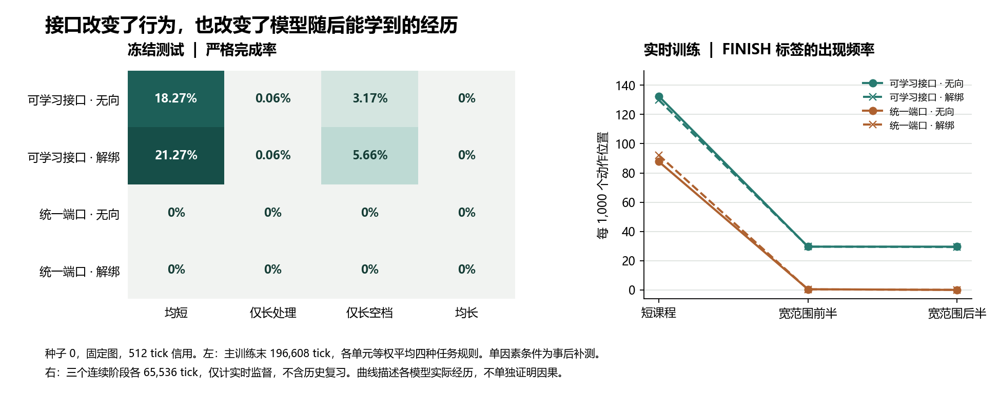

# 无向神经图、完整时间信用与增删策略对照

协议冻结于 2026-10-30。11 月 2 日，42 个训练分支和 1,680 个冻结评估分叉全部完成。三种子结果见第 10 节，11 月 1 日的阶段诊断保留在第 9 节。[上一轮实验](organization-experiment-2026-10-30.md)

## 1. 本轮分别回答什么

旧的“只退出优于生长＋退出”值得认真处理。[结构因素实验](factors-experiment-2026-10-29.md)同源比较中，grow 相对 retire 的旧条件严格完成低 `28.27 ± 3.89` 个百分点；但 fixed_shrink 与 retire 只差 `0.10 ± 1.63` 个百分点。它支持重新检查生长与优化策略，不证明永久退出本身必要，也不能唯一归因于某一个原因。

本轮分开比较：共享无向权重与方向解绑；保留可训练接口与全部节点同图；有限时间信用与完整在线敏感度；固定、只允许生长、只允许渐退/退出、二者结合。改变课程的对照另列，不能把这些因素合成一个“更复杂模型”后解释收益。

## 2. 真正共享的无向连接

所有节点服从同一个连续场，没有 bank、层或指定的记忆/计时模块：

```text
dh/dt = -h + W tanh(h)
```

每个无序对 `{i,j}` 只有一个共享参数 `s`：`W_ij=W_ji=s/sqrt(2)`。无向模型没有第二个反向权重，也不是先分别更新两个方向再对称化。连接资格与生长/退出以这个 pair 为单位，两个方向同时改变。零自环是本实验的配置，不是对无向图的普遍规定。

方向解绑控制另给每对一个 `a`：`W_ij=(s+a)/sqrt(2)`、`W_ji=(s-a)/sqrt(2)`，出生时 `a=0`。它从完全相同的物理 W 出发，但随后可以形成不对称作用；pair 资格仍共同控制两方向。此对照检验方向自由度，不等同于两个方向独立生死的另一套策略。正交坐标让参数范数对应 W 的 Frobenius 范数，但 Adam 和裁剪仍工作在不同的参数空间，不能称为所有优化条件数学等价。

正式规模为 80 个状态节点、每 actor 两个并行槽、四套上下文规则、56 项公开输入和 22 个动作 logits。初始图连通，每个节点有 16 个不同邻居，共 640 个无序 pair。通过随机重标号 regular ring 和保持度数的换边生成，明确不宣称均匀采样全部 regular 图。训练后不强制保持度数或连通性。

这张连通出生图的无向独立环数为 `640−80+1=561`。这是图论上环空间的维数，不是 561 个可独立执行的程序，也不是网络会沿环持续振荡的证据。

初始权重用一个全局尺度归一到 `||W||F=.6 sqrt(80)`，不逐行破坏对称。这个值只定义出生，不限制训练后的谱。每步记录实际谱与不对称程度；真实无向耦合由参数化保证。

## 3. 两种输入输出安排都做

| 接口 | 实际结构 | 出生安排 |
|---|---|---|
| core | 内部图无向，另有可训练的输入线性映射和输出读出 | 映射初始化成下述固定端口选择器 |
| ports | 80 个节点在同一图；56 个输入端口、22 个输出端口、2 个没有外部端口的节点 | 没有可训练 encoder、head 或输出 bias |

ports 的输入节点不钳制、不清零，输出节点也参与双向反馈；80 个节点都持续演化，都可以参与内部计算。端口位置是外部接口约定，不代表只有两个节点能保存信息。图允许输入—输入、输入—输出、输出—输出及其他任意 pair，不规定前馈方向。

共同外部输入尺度为每槽 duration 除以 16、window 除以 2.5，其余公开信息原样；脉冲增量系数为 `.25`。输出读选定节点的原始状态作为 logits。core 的接口从相同选择器出生，保证两接口及两种方向模式的物理 W、状态推进和完整输入输出函数在出生时相同。

两种接口的自由参数数不同：ports 无向/解绑为 **3,160/6,320**，core 为 **9,422/12,582**。同节点数、同出生函数不是同参数量或同运算量。当前使用 dense 矩阵计算，不按有效边数虚报稀疏计算节省。

两种接口还具有不同的**即时反应能力**。[模型](../experiments/undirected/model.py)先按上一状态推进时间，再注入本次观察，最后读出动作。ports 的输入节点和输出节点不重合，所以固定上一状态时，无论边权如何，本次脉冲都不能改变同一 tick 的输出；最早要等到下一次状态推进。core 出生时也一样，但学习后的编码器和读出可以形成同 tick 的输入到输出通路。因此接口比较包含参数量、路由和反应延迟三方面差异。判断无向共享本身的作用，要看**同一接口内**共享与解绑的配对。

## 4. 128 tick 不再被当作所有方法的信用上限

所有条件仍每 128 live tick 做一次 Adam，以固定更新频率和监督位置；数值 h、世界与合同始终连续。关键区别在于梯度可以追溯多远：

| 方法 | 当前损失位置 | live 信用路径 |
|---|---|---|
| tbptt128 | 当前 128 tick | 当前块，128 上限 |
| recorded512 | 同上 | 最近四块的真实记录轨迹，512 上限 |
| rtrl | 同上 | 从出生延续的完整状态—参数敏感度，不在块边界清空 |
| rtrl_reset | 同上 | 故意不用此前敏感度；计算量仍包含相同 Jacobian 和乘法 |

recorded512 使用历史各块实际用过的参数，重建真实数值轨迹。每个历史参数被视为 `recorded_parameter + delta`，delta 是共同的当前参数扰动；只对最后一块损失求导。它不会用当前参数假装重演过去，也不复用越过 optimizer.step 的旧计算图。

完整 block-RTRL 保存 `S=dh/dtheta`，每块按下式推进：

```text
S_end = J_block S_start + K_block
g_live = dL_block/dtheta_local + (dL_block/dh_start) S_start
```

这里 `J_block` 包含跨神经元作用，S 不是对角近似。计算一个块的 Jacobian 可以用局部反传，但整个学习信用由 S 跨块传递，不能据计算块长说它仍只看 128 tick。参数、优化器、结构事件、实际行动和世界反馈被当作已记录条件；该导数不穿过 Adam、结构选择或环境决策。在线改变参数时，它是记录参数轨迹上的共同加性扰动敏感度，不是“从出生一直用当前参数”的梯度。

辅助历史复习仍单独采用 warmup128＋suffix128，所有组保持同一协议；本轮取消的是 live 信用硬上限，不声称所有重放目标都已有无限历史。S 是训练状态，不作为推理时额外可读取的内容记忆。自然动力学仍可能让旧梯度衰减。

[跨 1,024 tick 的机械校验](evidence/undirected-2026-10-30/credit-path-check.json)只在 tick 0 给输入，损失位于 1,024–1,151，中间实际改变参数八次。有限128/512/1024窗口的 encoder 梯度均为零，RTRL 非零，并与完整记录轨迹反传、有限差分一致。这证明实现存在相应长信用路径，不是任务学习成绩；测试故意使用一个慢模态，不证明任意网络都能保持内容。

这个校验使用保留 encoder 的微型无向核心。ports 没有 encoder，其全边梯度另外通过完整记录轨迹反传、有限差分和保存恢复测试核对，不把两种参数布局混为一谈。

## 5. 用相同策略拆开生长和退出开关

四个带相同探测预算的条件为 fixed_probe、grow、retire、both。另有不做结构探测的 fixed，用于主模型/信用对照。四组在候选构造、损失、窗口和探测计算上相同，只改变是否允许接受出生或渐退，避免再次把不同算法名称直接比较。

每八次更新根据窗口梯度和真实 Adam 统计形成最多四个出生、四个渐退候选，下一真实块再做四次前向探测：基线、联合出生、完整移除诊断、有限减弱。完整移除始终只测量后回滚；真正的退出来自被接受的有限减弱最终到零。出生与减弱各自按近期/历史平均损失下降接受，允许只生、只退、同时发生或都不发生，不强一增一删。

所有潜在边保留真实梯度和 Adam 统计；未允许的坐标在实际前向边界保持零。对零权重求导是平滑潜在图的反事实敏感度，不是对 masked forward 使用伪梯度。结构与优化器决策不在 RTRL 导数中反传；S 不因生长或退出清空。

候选数是搜索幅度，四次联合前向是另外的计算预算。有限预算会限制总增长，不把未铺满图当作自动容量选择成功。平均目标下降仍可损害历史部分；联合批的损伤也不能归因到某条单边。没有预先划分不可变长期连接或指定功能模块。

## 6. 课程、矩阵与状态

默认课程在前 65,536 tick 使用短范围，随后使用宽范围；主训练总长 196,608，之后撤出 future NEW 的 family 0 共 32,768，再返回 8,192，总计 **237,568 live tick、1,856 次更新**。另有从出生一直 wide 的课程对照。同 tick 不等于同请求数，课程比较同时改变训练数据的分布与顺序，不称纯顺序效应。

十四个条件、每个三种子，共计划 **42 组**：

- core/ports × 无向/方向解绑，在 recorded512 下比较：四条件。
- ports 无向另做 tbptt128、rtrl、rtrl_reset：三条件。
- ports 方向解绑另做 rtrl：一条件。
- ports 无向 rtrl 下做 fixed_probe/grow/retire/both：四条件。
- ports 无向 fixed 的 tbptt128/rtrl 另做 wide-only 课程：两条件。

这不是所有因素的完整笛卡尔积，未运行的交互不能推断。模型、h、世界、Adam、pair资格、历史库、完整S或记录tape、pending与RNG共同保存恢复。课程变化只改变未来请求，不清空未完成合同或状态。

保存六个预定检查点；五个非零检查点各评估四 family × short/long_both × 2,048 tick，共计划 **1,680 个冻结分叉**。先判断能力是否获得，再判断保持。数值失败保留最后完整状态，明确缺少同预算终点，不赋零分、不换种子、不通过清空/截断S救回；其他执行故障与算法数值失败分开处理。

**任务真正要求记多久？** 在 `dt=.25` 下，从当前有效 NEW/REPLACE 提示到这份合同的截止时间，最长是 `(16+2.5)/.25=74` 个 tick。REPLACE 会重新公开版本、内容、时间和情境；长空档也不要求一直保存已结束合同的答案。即使线索与监督只隔几十 tick，它们仍可能位于 128 分段的两侧；512 窗口则已经覆盖单份合同的明确线索到截止期。更早背景状态仍会影响梯度，但这项行为任务并不强迫模型在 512 tick 后复述一次性线索。撤出家族后的能力保持、单次请求的状态记忆、远期梯度存在是三项不同的结论。依据见[合同时间与教师](../experiments/continuity/world.py)和[情境提示](../experiments/lifelong/world.py)。

## 7. 无向性的理论边界

对固定对称 W、没有输入脉冲的理想连续流，可以写出 Hopfield 型能量下降关系，因此这个最小核心不产生非平凡的持续自治极限环。持续输入、权重变化和有限步 Heun 不满足同一保证；瞬态计时和多稳态也没有被排除。并且 W 对称不等于状态线性化 Jacobian 对称。[Hopfield 原论文](https://authors.library.caltech.edu/records/rhj8z-8dj90)

这只是所选动力学的边界，不是“所有无向图都不能有复杂时间行为”。EP/TCL 等方法的平衡或准静态假设也不能自动替代持续任务的长期时间信用。原始来源和适用范围见[研究核对](evidence/undirected-2026-10-30/research-notes.md)。

## 8. 执行状态

11 月 2 日复核时，42 个分支均成功到达 237,568 tick，每个分支完成了 40 个冻结评估分叉。42 份独立历史校验均已通过。原报告在第 10 节所述的固定图跨组检查处停止。修订的报告逐块重放训练中的世界、教师标签、模型状态和实际动作，独立列出跨组比较的结果。[收尾状态](../data/undirected/completion-v4/finish-status.json)

运行入口、日志位置和待完成事项见[执行记录](evidence/undirected-2026-10-30/run-status.md)。完整 RTRL 的成本显著高于有限窗口组；操作层可以调整进程调度，但不能据中途成绩改变学习规则、预算、种子或成功标准。

三种子配对表和全部图表已于 11 月 2 日导出。[正式结果及图表入口](undirected-results-2026-10-30.md)

## 9. 11 月 1 日的阶段性实测

以下两项使用**不同的检查点和学习方法**：接口行为用主训练末的 `recorded512` 模型，已核对种子 0、1；结构事件用种子 0 更早的 `rtrl` 存档。不能将结构事件解释为接口行为好坏的原因。

| 512 tick 信用、固定图、短到长课程 | 种子 0：短任务严格完成 | 种子 1：短任务严格完成 | 长处理＋长空档 |
|---|---:|---:|---|
| 可学习接口，内部共享无向权重 | 18.27% | 17.25% | 两种子均已启动全部成熟请求，但均无合法 FINISH 尝试 |
| 可学习接口，方向解绑 | 21.27% | 19.55% | 同上 |
| 统一端口图，共享无向权重 | 0% | 0% | 两种子均没有启动成熟请求 |
| 统一端口图，方向解绑 | 0% | 0% | 同上 |

[两个种子分别列值的来源表](evidence/undirected-2026-10-30/interim-interfaces-seed0-seed1-2026-11-01.md)含普通完成、空闲误动作和实际分母。种子 1 的 core 两组均为 684/684 个成熟请求成功启动、零次合法 FINISH。未用已有两个种子代替三种子统计。下文的细分计数、额外时间测量及图均明确取种子 0。

- **接口：**[四组冻结对照](evidence/undirected-2026-10-30/interim-interfaces-seed0-2026-11-01.md)已齐，保留逐族原始分母。core/共享与 core/解绑在主训练末短任务的普通完成为 28.51%、32.33%，严格完成为 18.27%、21.27%。ports 两组在短任务的 4,472 个成熟请求中均无成功 BEGIN，普通/严格完成均为零；在短、长共八次分叉中各有 262,144 个动作机会，均未发出任何非 WAIT 动作。低空闲误动作在这里是一种沉默策略，不是可靠停止能力。
- **长任务的两个零分含义不同：**各组四族合计 636 个成熟请求。core 两组均全部 BEGIN 且有合法完成机会，但合法窗口内实际 FINISH 尝试均为零。第一次合法机会只比较八种 FINISH 内容时，分别有 272/636、269/636 次首选正确。ports 两组一次也没有启动，故没有首次合法内容读出，其分母为零，不能写成内容准确率 0%。这能定位失败的行为阶段，未确定训练原因。
- **端口组并非从出生就只等：**再读上述四组核验所绑定的完整评估文件，在短课程末（65,536 tick）的短任务分叉中，两个 ports 组各自在 131,072/131,072 个动作机会都尝试 BEGIN，FINISH 尝试是零。到 131,072 tick 及其后三个检查点，同样的短任务分叉全部变成 WAIT。这里观察到的是从“一直启动”转为“一直等待”，两个极端都没有得到完整任务。等 tick 课程同时改变了真实经历数和标签分布，不能据此单独怪罪课程顺序。
- **闭环训练里的监督也不相同：**在主训练最后 65,536 tick（每组 1,048,576 个 job 位置）内，ports 两组都是零次非 WAIT 动作；实际因果教师仍给出 104,015 个 BEGIN 标签，却没有任何 live FINISH 标签。core 两组在同一时段分别有 30,995、30,740 个 live FINISH 标签。[教师](../experiments/continuity/world.py)只有在请求已经成功启动后才会给 FINISH 监督。这是原始实时轨迹的计数，历史复习可能提供其他标签，不能写成完全没有学习过 FINISH。它提供了可检验的闭环解释：启动失败会减少后续阶段的学习机会，但没有辨认第一次启动失败的原因。
- **结构：**[同预算存档核验](evidence/undirected-2026-10-30/interim-131072-seed0.json)恢复 131,072 tick 的实际模型与训练状态。只生组从 640 条资格边到 976；只退组接受 67 批减弱，仍为 640 条，实际退出零；联合组接受 90 批生长及 58 批减弱，共生长 360 条，到 1,000 条，实际退出也是零。联合组 23/90 批已接受生长使所抽历史损失增加，这是批次级训练诊断，不是旧任务遗忘率。
- **退出卡在哪里：**两组各有 127 次候选窗口、508 个减弱候选。提案时只退组有 108 窗的资格池含 `|w|≤0.001` 的边，联合组有 115 窗；两组被选中的阈值内边均为零。到实际执行时，所选边仍没有一条小到可被试置零。因此此处是**排序没有把可归零的边送去试删**；数据不支持“试删后总是被损失否决”。小权重不等于对任务无用，这个诊断也不支持强删小权重边。
- **全删探测提供的额外证据：**虽然资格退出为零，但[当时已执行、随后回滚的整批全删探测](evidence/undirected-2026-10-30/interim-131072-seed0-full-ablation.json)中，只退组 58/127 批、联合组 48/127 批降低了当下的混合损失；其中分别有 36 和 32 批同时降低实时和历史两项。说明“损失支持某次试删”和“机制实际允许这次退出”确实不同。一次训练样本上的改善不能代替随后长期表现的验证。
- **时间信用：**在这 1,024 次真实更新里，固定无向图完整 RTRL 的跨块修正范数与当前块局部梯度范数之比，中位数为 **0.0954**；主动清空组为 **0**。说明跨块通路在正式学习时确实产生了非零更新贡献。这个比值没有给出梯度源自多少 tick 前，更不能读成 9.54% 的能力收益。[梯度及结构核验](evidence/undirected-2026-10-30/interim-131072-seed0.md)

原协议的 `long_both` 同时改变处理时长和请求间空档。[32 个补充分叉](evidence/undirected-2026-10-30/time-factor-interim-2026-11-01.md)已在同一批完整冻结存档上测完：只延长处理时长时，core/共享与 core/解绑的严格完成均为 **1/1,584（0.063%）**；只延长空档时分别为 **28/884（3.17%）**、**50/884（5.66%）**。两个 ports 模型在四种时间组合下严格完成均为零。这是看过中期结果后的测量，不进入 42 分支或 1,680 个原定分叉的计数，也不把四个 family 当作四个训练种子。



这批结果给出两个可以分开改的环节。学习上，保留同一无向图和自由行动的测试，单独检验训练时获得少量成功启动后的经历，能否打破“始终等待、因而没有实时结束标签”的闭环。结构上，在相同探测预算下只改一个开关：例如允许已经测过的整批全删在验证通过后生效，与既有渐退作对照；继续测随后的新旧任务保持，不能把一次即时损失下降认作长期安全。完整 RTRL 是否提高行为仍要等它自己的三种子对照，不能用这些 `recorded512` 行为数字作答。

## 10. 11 月 2 日的三种子结果

下表取主训练末 196,608 tick。同一种子内先等权平均四种任务规则，再平均种子 0、1、2。严格完成要求成熟请求最后成功且中途无错。长条件同时延长处理时间和任务间空档。复读核对了训练与评估队列绑定的输出、42 份评估文件、每个分叉的请求数和空闲机会分母。[逐种子数据及配对差](../data/undirected/independent-score-check-2026-11-02/verified-scores.json)

| 512 tick 信用，固定图，短到长课程 | 短任务普通完成 | 短任务严格完成 | 长条件严格完成 |
|---|---:|---:|---:|
| 可学习接口，共享无向权重 | 27.59% | 17.17% | 0% |
| 可学习接口，方向解绑 | 33.89% | 20.35% | 0.10% |
| 统一端口，共享无向权重 | 0% | 0% | 0% |
| 统一端口，方向解绑 | 0% | 0% | 0% |

可学习接口使短任务产生了成功行为。在长条件下，共享权重组的三个种子均启动全部成熟请求，合法窗口内的 FINISH 尝试合计为零。方向解绑组在种子 2 的 648 个成熟请求中有 6 次合法 FINISH 尝试，完成了 2 个。种子 0 和 1 仍是零完成。这些数值衡量的是主训练末的能力获得。

统一端口的 12 个条件覆盖三种子，共 36 个训练分支。它们在五个检查点的 1,440 个评估分叉中均为零完成。从 131,072 tick 开始的每个已测检查点，短任务和长条件下的所有动作机会均选择 WAIT。固定无向图、短到长课程下，完整 RTRL 三个种子在主训练 1,536 次更新里均有 1,535 次非零跨块梯度修正，主动清空组均为零。保留这些导数后，统一端口模型仍未学会自主完成请求。完整 RTRL 的行为对照只覆盖统一端口模型。

到最终 237,568 tick，只退组的三个种子都保留出生时的 640 条边。联合组按种子顺序新增 564、564、532 条，最终分别有 1,204、1,204、1,172 条。两个允许退出的组在整个训练期都没有实际退出，行为比较对应的是减弱权重与生长加减弱。

固定图与“做结构探测后全部回滚”的预期是逐位相同。种子 1 和 2 在受检学习轨迹上满足这一预期，种子 0 未通过。144,896 tick 处首先记录到信用状态哈希和敏感度范数的差异。下一次更新后，3,160 个共享边参数中有 1 个相差约 8.33×10⁻¹⁷。到终点，单个参数的最大绝对差为 0.007705，隐藏状态的最大绝对差为 0.06767。该种子的训练动作与世界轨迹仍相同，40 个评估分叉的动作和主要完成计数也都相同，部分内部诊断计数发生了变化。最初差异的来源仍待确定。[首次报告的严格检查日志](../data/undirected/completion-v2/report-001.log)
